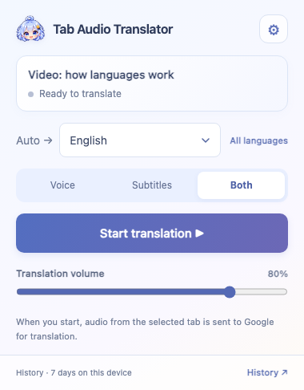
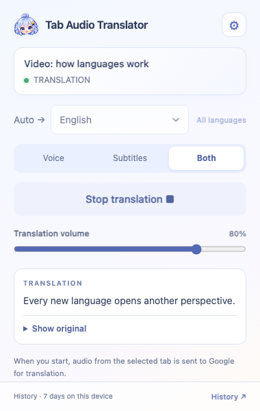
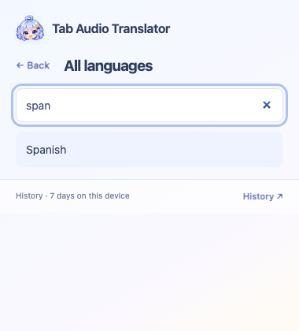
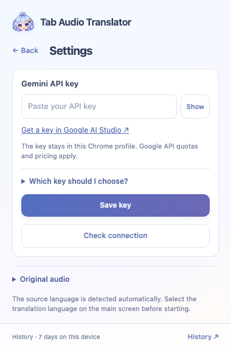
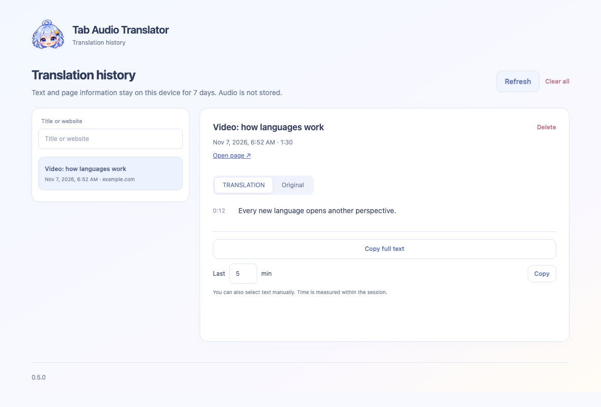

# Tab Audio Translator

**English** | [Русский](README.ru.md)

Listen to videos in your language. This Chrome extension translates **audio from a selected tab** using Google Gemini, with translated speech and subtitles.

**Version 0.5.0 · 0BSD license · Bring your own Gemini API key**

> The extension is free to use and modify. Google sets Gemini API availability, quotas and pricing. A subscription to the Gemini consumer app does not replace a Gemini API key.

<p>
  
  
</p>

## Features

- Translate speech from the current tab, including videos and live streams.
- Choose **Voice**, **Subtitles** or **Both**.
- Detect the source language automatically and suggest a target language from Chrome's language settings.
- Pick from 12 common languages or search the full list of 78 target options.
- Match the interface to your target language: 12 interface languages are available, with English as the fallback.
- Keep original text, translations and page details locally for 7 days, with search, copy and deletion controls.

This translates audio, rather than all text on a web page. You need an internet connection, Google Chrome 116 or later and access to the selected Gemini API model.

The screenshots use **example text** to illustrate the interface.

## Install in Chrome

Installation is currently manual. Choose the folder that matches your download:

| Download | Folder to load in Chrome |
|---|---|
| Ready-to-install `tab-audio-translator-v0.5.0.zip` from Releases | The extracted folder with **`manifest.json` directly inside it** |
| Source code from **Code → Download ZIP** or a repository clone | The **`extension`** folder inside the project |

1. Extract the ZIP to a permanent location.
2. Open `chrome://extensions` in Chrome's address bar.
3. Enable **Developer mode** in the top-right corner.
4. Click **Load unpacked** and select the folder described above.
5. Optionally pin **Tab Audio Translator** using Chrome's puzzle-piece Extensions menu. The name is localized in Russian Chrome.

**You do not need Node.js, npm or terminal commands to install the extension.** Keep the folder in place after installation: Chrome loads the extension from it.

[Detailed installation and update guide](docs/INSTALLATION.md).

## Your first translation

1. Open a regular web tab with a video or other audio.
2. Open the extension → **⚙ Settings**.
3. Paste your Gemini key, click **Save key**, then **Check connection**.
4. Go back and choose a language and **Voice / Subtitles / Both**.
5. Click **Start translation** and play the video.
6. Click **Stop translation** when you are done.

Need help connecting? [How to get and choose a Gemini key](docs/GEMINI-KEY.md). A short guide is also available inside Settings.

## Languages and audio

- **Auto →** means the language being spoken is detected automatically.
- **Same as Chrome** chooses the target language from Chrome's interface language. Manual choices are remembered.
- Click **All languages** to search for a language missing from the short list. Your selected language is added to that list.
- Translation volume is on the main screen. Original audio volume is under **Original audio** in Settings.
- **Subtitles** mode mutes translated speech but uses the same Gemini processing. It does not promise lower API costs.
- English is the fallback language. Russian and the other supported interface languages remain available through the target-language selector.

<p>
  
  
</p>

## History and privacy

Open **History ↗** to read the original or translation, copy the full text or the last few minutes, and delete saved sessions.



- Audio from the selected tab is sent to **Google** while translation is running.
- Your key, settings, text and page details are stored in this Chrome profile without synchronization.
- Text history is kept for 7 days. Audio recordings are not archived.
- The extension has no server of its own, advertising or analytics.

[Full data-handling description](extension/PRIVACY.md). Google's audio-processing terms depend on the API and plan you use.

## Troubleshooting

| Problem | What to check |
|---|---|
| Chrome cannot load the extension | Extract the ZIP and choose the folder containing `manifest.json` |
| The key is rejected | Use a Gemini API key, save it and check the connection in Settings |
| A quota error appears | Check model access and quotas for your project in Google AI Studio |
| Nothing is translated | Make sure speech is playing in the selected tab; check your network, translation volume and Gemini access |
| Subtitles are missing | Choose Subtitles or Both; try a regular web page rather than a Chrome internal page |
| Recent changes are missing | Stop translation and reload the extension using ⟳ in `chrome://extensions` |

Translation can be delayed or inaccurate. Site support depends on tab-audio availability and whether subtitles can be displayed on the page. Not all languages or sites have been tested. See the [Gemini Live Translation documentation](https://ai.google.dev/gemini-api/docs/live-api/live-translate) for model capabilities.

Report bugs in the repository's **Issues** tab. Include your Chrome version, operating system, mode, target language and error message. Use a public page as an example; do not share your API key or private history.

## Development

Requires **Node.js 20+**, npm and Git. Packaging uses `zip` and `unzip` (included with macOS; Linux may require installation). These tools are only needed for development, not for installing the extension.

```sh
npm ci
npm test
npm run check
npx playwright install chromium
npm run test:ui
npm run check:publish
npm run package
```

`npm run package` creates an installable extension ZIP and a separate source archive in `dist/`. `npm run docs:screenshots` regenerates English and Russian screenshots as described in [the screenshot guide](docs/MEDIA.md).

Tests use mocked Chrome, WebSocket and audio APIs. They do not need a real Gemini key or modify your Chrome profile. Screenshots use example data. The author has manually verified real translation in Chrome; automated checks do not establish Google API availability for other accounts or regions.

## License

The project's own code and original assets are under **[0BSD](LICENSE)**. You may use, modify and redistribute them, including commercially, without an attribution requirement.

[License scope](extension/LICENSING.md). The project license does not replace the terms of Google Gemini or other external services.
