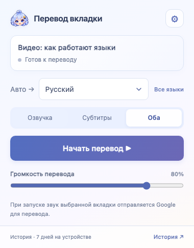
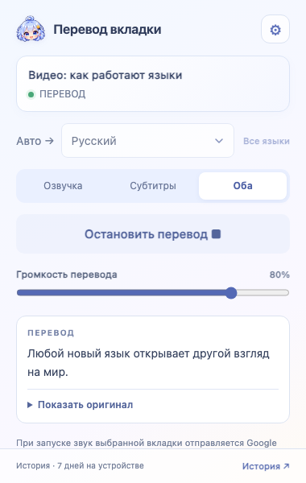
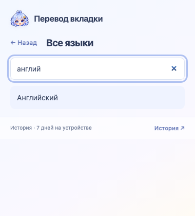
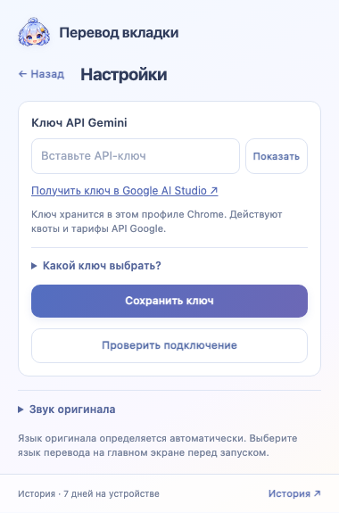
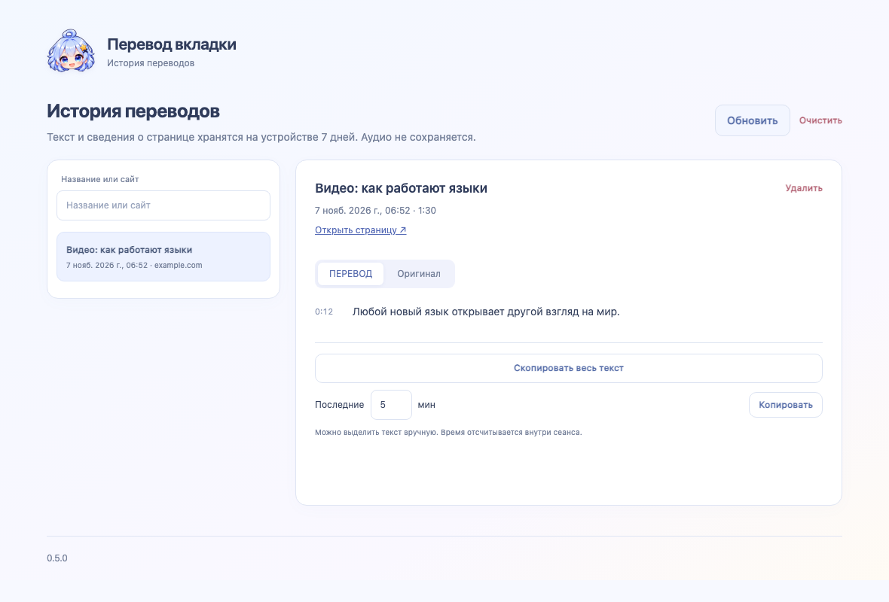

# Перевод вкладки

[English](README.md) | **Русский**

Слушайте видео на своём языке: расширение Chrome переводит **звук выбранной вкладки** через Google Gemini, воспроизводит озвучку и показывает субтитры.

**Версия 0.5.0 · Лицензия 0BSD · Нужен собственный API-ключ Gemini**

> Расширение распространяется свободно. Доступ к Gemini, квоты и стоимость перевода определяет Google. Подписка на приложение Gemini сама по себе не заменяет ключ Gemini API.

<p>
  
  
</p>

## Что умеет

- Переводить речь из текущей вкладки, например из видео или трансляции.
- Работать в режимах **«Озвучка»**, **«Субтитры»** и **«Оба»**.
- Автоматически определять язык оригинала и предлагать язык перевода из настроек Chrome.
- Давать быстрый доступ к 12 основным языкам и поиск по полному списку из 78 вариантов.
- Переключать интерфейс вслед за языком перевода: доступны 12 языков интерфейса, для остальных используется английский.
- Сохранять оригинал, перевод и сведения о странице локально на 7 дней; искать, копировать и удалять записи.

Это перевод звука, а не перевод всего текста веб-страницы. Для работы нужны интернет, Google Chrome 116 или новее и доступ к выбранной модели Gemini API.

На скриншотах — **пример текста**, показывающий интерфейс расширения.

## Установка в Chrome

Пока расширение устанавливается вручную. Есть два способа:

| Что скачали | Какую папку загружать в Chrome |
|---|---|
| Готовый архив `tab-audio-translator-v0.5.0.zip` из Releases | Распакованную папку, **внутри которой сразу лежит `manifest.json`** |
| Исходники через **Code → Download ZIP** или клонирование репозитория | Папку **`extension`** внутри проекта |

1. Распакуйте ZIP в постоянное место. Не оставляйте расширение во временной папке.
2. Откройте в адресной строке Chrome `chrome://extensions`.
3. Включите **«Режим разработчика»** справа вверху.
4. Нажмите **«Загрузить распакованное расширение»** и выберите папку из таблицы выше.
5. В меню Chrome с иконкой пазла закрепите **«Перевод вкладки»**, если хотите видеть кнопку на панели.

**Node.js, npm и запуск команд для обычной установки не нужны.** Папку расширения после установки не перемещайте: Chrome загружает файлы из неё.

[Подробная инструкция по установке и обновлению](docs/INSTALLATION.ru.md).

## Первый перевод

1. Откройте обычную вкладку с видео или другим звуком.
2. Нажмите иконку расширения → **⚙ Настройки**.
3. Вставьте свой ключ Gemini, нажмите **«Сохранить ключ»**, затем **«Проверить подключение»**.
4. Вернитесь назад. Выберите язык и режим **«Озвучка» / «Субтитры» / «Оба»**.
5. Нажмите **«Начать перевод»** и включите воспроизведение видео.
6. Для завершения нажмите **«Остановить перевод»**.

Нужна помощь с подключением? [Как получить и выбрать ключ Gemini](docs/GEMINI-KEY.ru.md). Подсказка также встроена в настройки расширения.

## Языки и звук

- **«Авто →»** слева означает автоматическое определение языка речи.
- **«Как в Chrome»** в списке означает выбор языка перевода по языку интерфейса браузера. Ручной выбор запоминается.
- Если нужного языка нет в коротком списке, нажмите **«Все языки»** и начните вводить название. Выбранный язык добавится в короткий список.
- На главном экране регулируется громкость перевода. Громкость оригинала — в настройках, в разделе **«Звук оригинала»**.
- В режиме **«Субтитры»** озвучка перевода отключена, но обработка Gemini остаётся той же. Этот режим не обещает меньшую стоимость API.

<p>
  
  
</p>

## История и конфиденциальность

Нажмите **«История ↗»**, чтобы прочитать оригинал или перевод, скопировать весь текст либо последние несколько минут и удалить записи.



- Звук выбранной вкладки во время запущенного перевода отправляется **Google**.
- Ключ, настройки, тексты и сведения о страницах хранятся в этом профиле Chrome, без синхронизации.
- История хранится 7 дней. Аудиозаписи в архив не входят.
- У расширения нет собственного сервера, рекламы и аналитики.

[Полное описание обработки данных](extension/PRIVACY.ru.md). Условия обработки аудио Google зависят от API и тарифа, которым вы пользуетесь.

## Если что-то не работает

| Ситуация | Что проверить |
|---|---|
| Расширение не загружается | Выбрана ли папка, внутри которой находится `manifest.json`; ZIP должен быть распакован |
| Не принимается ключ | Скопирован ли именно ключ Gemini API; сохраните его и проверьте подключение в настройках |
| Сообщение о лимите | Квоты и доступ к модели в проекте Google AI Studio |
| Нет перевода | В выбранной вкладке должна звучать речь; проверьте сеть, громкость перевода и доступ к Gemini |
| Субтитры не появились | Выбран ли режим «Субтитры» или «Оба»; попробуйте обычную веб-страницу вместо служебной страницы Chrome |
| Не видно последних изменений | Остановите перевод и перезагрузите расширение через ⟳ в `chrome://extensions` |

Перевод может запаздывать и ошибаться. Работа на конкретном сайте зависит от доступности звука вкладки и возможности показать на ней субтитры. Качество всех языков и работа на всех сайтах не проверялись. Официальный список возможностей модели — в [документации Gemini Live Translation](https://ai.google.dev/gemini-api/docs/live-api/live-translate).

Сообщить об ошибке можно через вкладку **Issues** репозитория. Укажите версию Chrome, систему, выбранный режим, язык и текст ошибки. Для примера используйте общедоступную страницу; API-ключ и личную историю прикладывать не нужно.

## Для разработчиков

Нужны **Node.js 20+**, npm и Git. Для сборки архивов скрипт использует `zip` и `unzip` (есть в macOS; в Linux могут потребовать установки). Эти инструменты нужны только для разработки и проверок, не для установки расширения.

```sh
npm ci
npm test
npm run check
npx playwright install chromium
npm run test:ui
npm run check:publish
npm run package
```

`npm run package` создаёт в `dist/` готовый ZIP расширения и отдельный архив исходников. `npm run docs:screenshots` пересоздаёт английские и русские скриншоты, как описано в [инструкции](docs/MEDIA.ru.md).

Тесты не используют настоящий ключ Gemini и не меняют пользовательский профиль Chrome. Интеграционная проверка соединяет основной обработчик с новым движком через имитацию WebSocket и аудиоустройств. Скриншоты также используют пример данных. Автор проверил реальный перевод в Chrome; автоматические проверки не заменяют проверку доступности Google API для другого аккаунта и региона.

## Лицензия

Собственный код и оригинальные ресурсы проекта распространяются под **[0BSD](LICENSE)**: их можно использовать, изменять и распространять, в том числе коммерчески, без требования указывать автора.

[Границы лицензии](extension/LICENSING.ru.md). Лицензия проекта не заменяет условия Google Gemini и других внешних сервисов.
